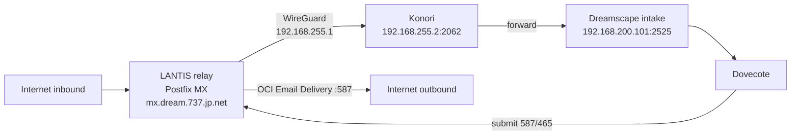

# Dreamscape production setup

Operator path for a Dreamscape host behind the LANTIS (Oracle) mail relay. This is not a NovelAI hosting guide. Personal, private use only — see the [README preface](../README.md#preface).

Secrets never belong in git. Use placeholders (`<RELAY_TOKEN>`, `<OCI_SMTP_USER>`, `<DKIM_SELECTOR>`, `example.invalid`) until you write real values on the host.

Mail intake, Spam folders, and the Exchange Server DSAP are **not on `main`**. They live on [PR #344](https://github.com/UiharuKazari2008/StaticForge/pull/344) (`cursor/dovecote-mail-gateway-a4cc`) and the sibling Exchange Server work. Treat them as **mail gateway (PR #344, off by default: `config.mailGateway.enabled`)**. Do not invent endpoints that are not in this tree.

| Surface | Where it lives | Default |
|---------|----------------|---------|
| Internal Dovecote (mailbox ↔ mailbox) | `main` (`modules/dovecoteMail.js`) | Always on |
| SMTP/LMTP intake `:2525`, outbound rewrite, Spam folder | PR #344 `modules/mailGateway*.js` | Off until `config.mailGateway.enabled` |
| Exchange Server DSAP + LANTIS relay API | Sibling Exchange Server branch (no published branch in this clone at write time) | TODO |

Linux package install, Node 20, seeds, and the clean-install CI test: **[CLEAN_INSTALL.md](./CLEAN_INSTALL.md)**. Workstation pack/sync/Docker: **[local-host.md](./local-host.md)**.

---

## 1. Architecture overview

Internet mail lands on LANTIS (Postfix MX). LANTIS filters, then forwards over WireGuard to Konori, which DNAT-forwards to Dreamscape intake. Intake files into Dovecote. Outbound submission goes back to LANTIS, which hands approved senders to OCI Email Delivery.



Dreamscape HTTP stays on **9220** (`web_server.js`, PM2 app `Dreamscape`). Intake is a separate SMTP/LMTP listener and only exists when the mail gateway is enabled.

---

## 2. External: LANTIS (Oracle) relay

**Not in this repo.** The following is the operator contract the gateway code on PR #344 expects. Confirm against the live LANTIS Postfix tree before treating a line as fact.

Postfix is the MX for `dream.737.jp.net` (`mx.dream.737.jp.net`).

| Piece | Contract |
|-------|----------|
| postscreen | DNSBLs: zen, spamcop, barracuda, psbl |
| Auth | SPF verify, DKIM verify, DMARC (OpenDMARC) |
| SpamAssassin milter | Inserts `X-Spam-*` **above** the relay `Received` |
| `Authentication-Results` | `authserv-id` `mx.dream.737.jp.net` (one A-R per method: dmarc / spf / dkim). Intake on PR #344 keeps **every** trusted A-R with that id |
| Strip inbound | Inbound `X-Spam-*` and forged A-R (foreign authserv-id) are stripped at the relay so only LANTIS stamps are trusted |
| Resolver | Local unbound |
| Policy | MTA-STS + TLS-RPT |
| Certs | Let's Encrypt for `mx.dream.737.jp.net` and `mta-sts.dream.737.jp.net` |
| Catch-all | Unknown local-parts rewrite to `mailroom.ops@dream.737.jp.net` and stamp `X-Original-To` (display only on intake) |
| Queue | 14-day queue lifetime (`maximal_queue_lifetime` 14d — **TODO:** confirm the live Postfix main.cf) |
| LAN submission | `192.168.255.1` ports **587** (STARTTLS) and **465** (implicit TLS). Dreamscape outbound defaults to this host (`modules/mailGateway.js` on PR #344) |

AUTH user the gateway defaults to: `dreamscape@dream.737.jp.net`. Password is `secure.config.json` `mailGateway.smtpPassword` or env `MAIL_GATEWAY_SMTP_PASSWORD`. Write it on the host as `<RELAY_TOKEN>`; never commit it.

TLS servername checked by the gateway: `mx.dream.737.jp.net`. Optional extra CA: `config.mailGateway.outbound.caPath`. `rejectUnauthorized` stays on; there is no plaintext fallback.

---

## 3. DNS (Vultr)

**Not in this repo.** Publish at the DNS host (Vultr). Placeholders only.

```
; MX
dream.737.jp.net.                    IN  MX   10 mx.dream.737.jp.net.

; SPF — include OCI Email Delivery
dream.737.jp.net.                    IN  TXT  "v=spf1 include:rp.oracleemaildelivery.com -all"

; DKIM (CNAME to the OCI selector)
<DKIM_SELECTOR>._domainkey.dream.737.jp.net.  IN  CNAME  <DKIM_SELECTOR>.<OCI_DKIM_CNAME>.example.invalid.

; DMARC
_dmarc.dream.737.jp.net.             IN  TXT  "v=DMARC1; p=quarantine; rua=mailto:mailroom.ops@dream.737.jp.net"

; MTA-STS
_mta-sts.dream.737.jp.net.           IN  TXT  "v=STSv1; id=<MTA_STS_ID>"
mta-sts.dream.737.jp.net.            IN  A    <LANTIS_PUBLIC_IPV4>
; HTTPS serves https://mta-sts.dream.737.jp.net/.well-known/mta-sts.txt (LE cert)

; TLS-RPT
_smtp._tls.dream.737.jp.net.         IN  TXT  "v=TLSRPTv1; rua=mailto:mailroom.ops@dream.737.jp.net"
```

**TODO:** confirm the live Vultr zone, the real OCI DKIM CNAME target, DMARC `p=` / rua, and the MTA-STS policy file. Do not copy production values into git.

---

## 4. OCI Email Delivery (outbound)

**Not in this repo.** LANTIS submits approved senders to OCI Email Delivery on port **587**.

| Item | Placeholder |
|------|-------------|
| SMTP host | `smtp.email.<OCI_REGION>.oraclecloud.com` (or the approved regional endpoint) |
| Port | 587 (STARTTLS) |
| User | `<OCI_SMTP_USER>` |
| Approved From | mapped `<name>.<dept>@dream.737.jp.net` addresses only (see §7) |

**TODO:** confirm the regional SMTP hostname and the approved-sender list in the OCI console. Envelope From for Yukimi is `kazari.ops@dream.737.jp.net` (PR #344 `toExternal('yukimi')`).

---

## 5. Network

| Host | Address | Role |
|------|---------|------|
| LANTIS (WG) | `192.168.255.1` | Postfix; only peer Dreamscape intake accepts |
| Konori (WG) | `192.168.255.2` | Forwards `192.168.255.2:2062` → `192.168.200.101:2525` |
| Dreamscape intake | `192.168.200.101:2525` | PR #344 default bind (vlan10, not `0.0.0.0`) |

On the Dreamscape host, a **static route** for `192.168.255.1` via `192.168.200.126` is required so intake can talk back to LANTIS. **TODO:** confirm the live `ip route` and the Konori DNAT rule; those live on the boxes, not in this repo.

PR #344 allowlist is `config.mailGateway.inbound.allowFrom` default `["192.168.255.1"]`. Other peers get rejected before they consume a connection slot.

---

## 6. Internal: Dreamscape host

Debian/Ubuntu. Production process: PM2 app **`Dreamscape`** (`ecosystem.config.js` → `web_server.js`) under systemd **`pm2-kanmi`**. The installer (`scripts/install-linux.sh --with-service`) names the unit `pm2-$SERVICE_USER`; on this host that user is `kanmi`.

```bash
git clone https://yozora.bluesteel.737.jp.net/DreamScape/StaticForge.git dreamscape
cd dreamscape
sudo bash scripts/install-linux.sh --with-service
bash scripts/fetch-seeds.sh
```

| Need | Source |
|------|--------|
| Node.js **20+** (NodeSource), pnpm **10.33.0** (corepack, `packageManager`) | `scripts/install-linux.sh` |
| `build-essential` python3 pkg-config, cairo/pango/jpeg/gif/rsvg, hunspell, sqlite, ruby, git, zstd | same |
| `sessionSecret` | required; `web_server.js` refuses to boot without it |
| Runtime data | `~/dreamscape-data` (`DREAMSCAPE_DATA_DIR` or `config.json` `"dataDir"`) — `modules/runtimeDataPaths.js` |
| Seeds | `scripts/fetch-seeds.sh` from `https://yozora.bluesteel.737.jp.net/seeds/dreamscape/` (`SEED_BASE_URL` override). Verifies `SHA256SUMS` |

Do **not** keep gallery, cache, or Apocrypha issues inside the git tree. `~/dreamscape-data/apocrypha` is the live issue store.

### Config layout

Installer creates files only when missing (never overwrites). Maps: `config-maps/config.map.json`, `config-maps/secureConfig.map.json`.

| File | What belongs there |
|------|--------------------|
| `config.json` | `port` (9220), `public_hostname`, `pm2_process_name`, `mailGateway` (PR #344; `enabled` stays **false** until cutover), optional `dataDir` |
| `secure.config.json` | `sessionSecret`, `novelai.keys[].apiKey`, path UUIDs (`mcpPathUuid`, `vfsPathUuid`, …), `localWorkers` / `localWorker`, `loginKey` / `loginPin` / `readOnlyPin`, optional `mailGateway.smtpPassword` |
| `prompt.config.json`, `director.config.json`, `nax_generation_config.json` | App catalogs; not deploy secrets |

The installer writes random `loginKey` / PINs into **`config.json`**. Live PIN and header-login checks read **`secure.config.json`** (`web_server.js`, `modules/auth.js`). Copy those values into the secure file (or set them in Runes) before treating login as configured. **TODO:** the installer does not write PINs into `secure.config.json`.

NovelAI key: `secure.config.json` `novelai.keys[].apiKey` (empty in `scripts/templates/bootstrap-secure.json`). Env `NOVELAI_API_KEY` is also accepted (`modules/globalResources.js`).

Optional second PM2 app: `grimoire-browser` on `127.0.0.1:9330` (`docs/grimoire-remote-browser.md`). Not required for mail.

HTTP unix socket for SW notify: `/tmp/staticforge_mcp.sock` (`STATICFORGE_SOCKET_PATH`).

---

## 7. Intake, Dovecote, keys, workers, Exchange

### Intake `:2525` — mail gateway (PR #344, off by default: `config.mailGateway.enabled`)

When enabled, `modules/bootstrap/initSteps.js` starts `modules/mailGateway.js` after the HTTP server is ready.

| Default | Value (PR #344) |
|---------|-----------------|
| Bind | `192.168.200.101` (`DEFAULT_INBOUND_BIND`) |
| Port | `2525` |
| Allow | `192.168.255.1` only |
| Max connections | 16 (extra peers get `421`) |
| DATA cap | 10 MiB |
| Outbound | `192.168.255.1` `587` STARTTLS (or `465` implicit) |

Internal Dovecote sends (bare mailbox names) do not go through this module.

### Address translation

Public form: `<name>.<dept>@dream.737.jp.net`. Mapping is `config.mailGateway.mailboxes` (local-part → Dovecote owner). The **first** key per owner is the outbound local-part. Full addresses (`someone@icloud.example.invalid`) are never local recipients.

Shipped table on PR #344 (`modules/mailGatewayAddresses.js`):

| Local-part | Mailbox | Notes |
|------------|---------|-------|
| `kazari.ops` | `yukimi` | Outbound / public From |
| `yukimi`, `kazari`, `yukimi.kazari` | `yukimi` | Inbound aliases only |
| `sala.ops` | `sala` | |
| `menma.dev` / `rook.dev` / `cursor.dev` / `claude.dev` / `frost.dev` | same name | |
| `hoshino.apocrypha` | `hoshino` | |
| `ivory.studio` | `ivory` | |
| `guren.lab` | `guren` | |
| `chiyo.web` | `chiyo` | |
| `tsubame.ops` | `tsubame` | Primary mailroom mailbox |
| `mailroom.ops` | `tsubame` | Alias (LANTIS catch-all target) |

`tifa` and `pyra` stay in `pendingMailboxes` until a department is confirmed. `wren` is a Dovecote mailbox (Director) on `main`; it is **not** in the shipped public map.

External domains never resolve to a local mailbox. `ykazari@icloud.example.invalid` is outbound/external, not Yukimi.

### Dovecote folders and Spam trust (PR #344)

On `main`, folders are `inbox`, `outbox`, `sent`, `deleted`, `archive`. PR #344 adds **`spam`**.

Intake files to Spam only when a **trusted** header (topmost instance **above** the relay `Received`) matches:

- `X-Spam-Flag: YES`, or
- `X-Spam-Status` starting `Yes`, or
- trusted `Authentication-Results` (`authserv-id` `mx.dream.737.jp.net`) `dmarc=fail` with `p=quarantine` / `dis=QUARANTINE`

DKIM fail, `dmarc p=none`, and `Received-SPF` are display-only. `X-Spam-Flag: NO` never rescues a trusted Yes. `X-Original-To` is shown as “Originally to” and is never used for routing. `LANTIS_FORGED_OURS` is a warning badge.

Tsubame (mailroom role, Tsubame key only): can list/read/soft-purge/rescue Spam on every mailbox including Yukimi. Yukimi is Spam-only for that role (no Inbox read, no Inbox → Spam). A key **named Mailroom** maps to no mailbox. Ordinary bot keys stay owner-scoped.

### Mailbox keys and MCP

Application keys are `sfapp_…` (`modules/applicationAuthManager.js`). MCP is unlisted Streamable HTTP on `/{mcpPathUuid}` (`docs/client-api/mcp-connector.md`). No PIN, no `loginKey` on that surface.

| Key label | Mailbox / role |
|-----------|----------------|
| Named bot keys (`Menma`, `Guren`, `Chiyo`, `Ivory`, `Hoshino`, …) | That bot’s mailbox (`sfapp_dovecote`) |
| `Dreamscape Director` | Wren (`modules/directorAppKeyScopes.js`, `modules/cursorDirector.js`) |
| `Xi` | Active Xi runtime, else `cursor` (`modules/dovecoteIdentity.js`) |
| Tsubame key | `tsubame` + mailroom role (PR #344) |

Mint keys in Keychain / Security Center. Put the secret in a host file (`/etc/mail-watch/keys/<bot>.key` style). Never commit `sfapp_` values. Mail-watch poller: `scripts/mail-watch/README.md`.

### Upscale workers

`secure.config.json` `localWorkers` (or legacy `localWorker`). See [g10-upscaler.md](./g10-upscaler.md) and [services/ruiko-upscaler/README.md](../services/ruiko-upscaler/README.md).

```json
{
  "localWorkers": [
    {
      "id": "ruiko",
      "url": "http://<RUIKO_LAN_HOST>:8188",
      "key": "<RUIKO_WORKER_KEY>",
      "models": ["RealESRGAN_x4plus", "RealESRGAN_x4plus_anime_6B", "4x-UltraSharp"],
      "maxScale": 4,
      "priority": 20
    },
    {
      "id": "g10",
      "url": "http://127.0.0.1:8190",
      "key": "<G10_WORKER_KEY>",
      "models": ["realesr-animevideov3", "realesrgan-x4plus-anime"],
      "maxScale": 4,
      "priority": 10
    }
  ]
}
```

Do not publish 8188 on the internet.

### Exchange Server DSAP + LANTIS relay API

Sibling agent **Dreamscape Exchange Server (mail admin DSAP)** — no branch or PR in this clone at write time. Intended surfaces: a Dreamscape DSAP for mail admin, plus an API on the LANTIS relay (auth `<RELAY_TOKEN>`).

**TODO:** record the branch name, DSAP `launchId` / `dsap://` host, and relay API routes once that PR exists. Do not invent paths.

---

## 8. Restart procedure

Broadcast first. Then wait until Director / Xi / Wren are idle. Then restart **by process name**. Never `pm2 restart ecosystem.config.js` on the live host (that forces `updateEnv` and merges the caller’s env into Dreamscape). See `scripts/host-deploy.sh` and `scripts/director-idle-check.js`.

```bash
# 1. Tell connected clients (loopback). Needs STATICFORGE_APP_KEY or DEPLOY_DEV_LOGIN_KEY.
curl -sS -X POST "http://127.0.0.1:9220/agent/broadcast" \
  -H "Content-Type: application/json" \
  -H "Authorization: Bearer <APP_KEY>" \
  -d '{"message":"Dreamscape restart shortly","title":"Ops","level":"info","display":"toast"}'

# 2. Idle: Xi run records, Wren bwrap children of the Dreamscape pid, images/ mtime < 120s
node scripts/director-idle-check.js --json
# exit 0 idle, 1 busy, 2 unknown (Dreamscape pid missing)

# 3. Restart by name (systemd unit pm2-kanmi must already be the daemon)
systemctl is-active pm2-kanmi
pm2 flush Dreamscape
pm2 restart Dreamscape
pm2 reset Dreamscape

# Optional: SW cache notify (does not restart the server)
bash scripts/notify-service-worker-update.sh
```

Only restart when `director-idle-check` prints `IDLE`. Other agents ask Yukimi or Sala and stop. Host-deploy also refuses if `pm2-kanmi.service` is down (`scripts/host-deploy.sh --check-pm2`).

Client-reload broadcast (15s dialog) is `POST /agent/broadcast` with `"restart": true` (`deploy:restart-clients`). That is not a server restart.

---

## 9. Verification checklist and troubleshooting

### Checklist

- [ ] `node -v` is 20+; `pnpm -v` is 10.33.0
- [ ] `secure.config.json` has `sessionSecret` and a NovelAI key
- [ ] `pm2-kanmi.service` is active; `pm2 list` shows `Dreamscape` online
- [ ] `GET http://127.0.0.1:9220/status` (OPTIONS/GET) eventually has `isReady` and `runtimeCompileComplete`
- [ ] Seeds present (or tag/wiki empty by design): `bash scripts/fetch-seeds.sh`
- [ ] `~/dreamscape-data` exists and is outside the checkout
- [ ] **TODO (LANTIS):** MX, SPF, DKIM, DMARC, MTA-STS, TLS-RPT resolve as intended
- [ ] **TODO (network):** `ip route` shows `192.168.255.1` via `192.168.200.126`; Konori `2062` → `2525`
- [ ] Mail gateway stays **off** until PR #344 is merged and cutover is approved: `config.mailGateway.enabled` is not `true`
- [ ] After enable (PR #344 only): intake bound to `192.168.200.101:2525`; a connect from a non-allowlisted IP is refused
- [ ] After enable: a probe from `192.168.255.1` is accepted; unknown RCPT is rejected; catch-all lands in Tsubame with `X-Original-To`
- [ ] After enable: outbound From for Yukimi is `kazari.ops@dream.737.jp.net`; foreign domains are not local
- [ ] `node scripts/director-idle-check.js` exits 0 before any restart

### Troubleshooting

| Symptom | Check |
|---------|--------|
| Boot throw on session secret | `secure.config.json` `sessionSecret` missing (`web_server.js`) |
| `SQLITE_ERROR: no such table: worldcities` | `geo2city` postinstall — [README troubleshooting](../README.md#troubleshooting) |
| PINs / loginKey ignored | Values are in `config.json` but auth reads `secure.config.json` |
| `pm2` spawned a second daemon | Caller is not inside `pm2-kanmi`; do not run `pm2` from a runner/agent unit |
| Intake not listening | Gateway off, or PR #344 not in the tree; `enabled` must be `true` and the process must have restarted after that change |
| Intake accepts the world | `inbound.bind` must not be `0.0.0.0`; `allowFrom` must stay `192.168.255.1` |
| Spam folder empty / everything Spam | Only trust headers **above** Received with authserv-id `mx.dream.737.jp.net`. Confirm LANTIS strips forged `X-Spam-*` |
| Outbound TLS fail | Cert for `mx.dream.737.jp.net`; optional `caPath`; password `<RELAY_TOKEN>` |
| Director / Wren “busy” forever | Live Xi `~/.cache/dreamscape-xi/runs/*.json`, or a `bwrap` child of the Dreamscape pid, or a fresh file under `images/` |
| Seeds checksum fail | `SHA256SUMS` at `SEED_BASE_URL`; mismatch leaves the old file in place |

Do not merge, deploy, or enable the mail gateway from a docs PR.
